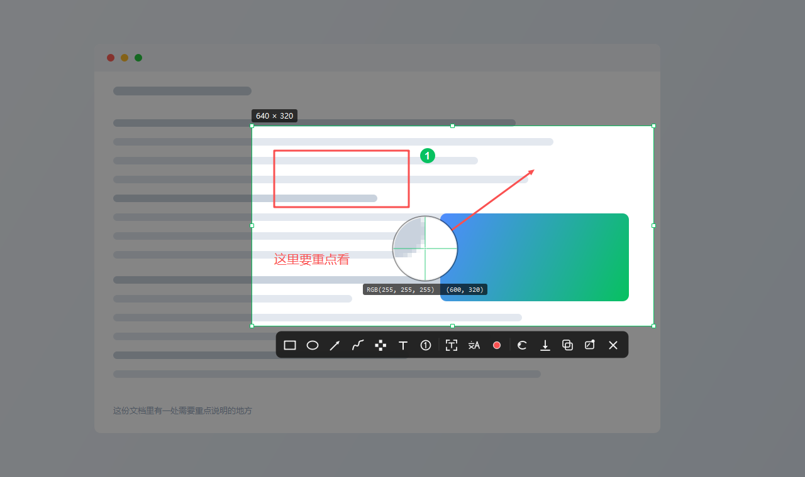
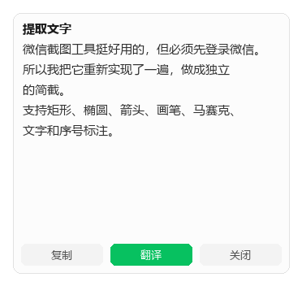
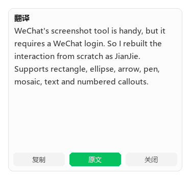

# 简截 · 微信风格的独立截图工具

一个**不需要登录微信**的截图工具，把微信截图（Alt+A）的那套交互原样搬了出来：
冻结屏幕 → 拖拽/单击框选窗口 → 放大镜取色 → 标注 → **提取文字 / 翻译** → 复制 / 保存 / 贴图。

> **直接下载**：[最新版 Release](https://github.com/QingHua27/Simple-screenshot/releases/latest)
> —— `JianJie-v1.0.0-win64.exe`，395 KB，免安装、免运行库，双击就能用。

有两个版本，功能一致：

| 版本 | 文件 | 体积 | 说明 |
|---|---|---|---|
| **原生版（推荐）** | `dist/简截.exe` | **395 KB** | C++ / Win32 / GDI+，免运行库，启动即开 |
| Python 版（保留） | `dist/简截-python版.exe` | 49 MB | PySide6 + PyInstaller，源码更易改 |



| 提取文字 | 翻译 |
|---|---|
|  |  |

---

## 一、为什么"提取"微信的截图工具不可行

先说结论：**没法提取，只能复刻。**

### 1. 截图功能

对本机安装的微信 4.1.15.13 做了实际勘察：

| 检查项 | 结果 |
|---|---|
| 安装目录 | `D:\Program Files (x86)\Tencent\Weixin\4.1.15.13`（约 873 MB） |
| 是否有独立截图 DLL | **没有**。老版本也没有 `PrScrn.dll` 之类的东西 |
| 截图代码位置 | 全部编译进 `Weixin.dll`（**201 MB** 单体文件） |
| 可定位的内部符号 | `ScreenshotView`、`ScreenshotUtils`、`ScreenshotWillStart/DidFinish`、`gScreenshotShortcutKey`、`WeChatScreenshotFormat`、`WeShotLongScreenshotmenu` |
| 导出函数 / 独立入口 | **无** |

### 2. OCR 插件（`WeChatOcr.bin`）

这个文件其实是 **ZIP 包**（`PK\x03\x04`），解开后是：

```
wxocr.dll                          24,486,952   ← 引擎本体
text_det_fp16_v2.xnet               1,447,764   ← 文本检测
text_rec_zh13562_fp16_v2.xnet       8,354,384   ← 文本识别
paragraph_det_fp16_v2.xnet          2,937,632
FPMMFG1V1.2.0.26.xnet / FPMMFG2...  8.5 MB      ← 版面分析
PrivacyDetectV8.0.26.xnet           5,351,702   ← 隐私信息检测
QBarDetV1.7.0.26.xnet / QBarSeg...              ← 二维码
charset_zh13562.txt / sohu_simp.txt
```

看起来很有希望 —— 但它只导出 3 个符号：

```
GetHandleVerifier      ← VMProtect 的典型防篡改导出
GetMergeOffsetInner    ← 同上
WeChatMain             ← 唯一的业务入口，代码已被虚拟化
```

也就是说 `wxocr.dll` 被 VMProtect 之类的壳保护过，`WeChatMain` 的真实逻辑跑在虚拟机上，
无法通过 `LoadLibrary` + 调用得到结果。**这条路也堵死了。**

所以这个项目走的是第二条路：**按微信截图的交互重新实现，OCR 用系统自带引擎。**

---

## 二、怎么用

双击 `dist\简截.exe`，程序常驻托盘（右下角绿色小图标），之后：

- 默认想用 **`Alt+A`**（和微信一致）；被占用时会自动降级到下一组可用组合
  （本机因为 `Alt+A` 被别的程序占着，实际落到了 `Alt+Z`）
- **再双击一次 exe** 也会让已在后台的实例直接开始截图
- 托盘图标**单击 / 双击**也能直接截图
- 右键托盘图标 → `快捷键` 可换成 `Alt+A` / `Ctrl+Alt+A` / `Ctrl+Shift+A` / `Alt+Z` 等
- 出问题时看 `%LOCALAPPDATA%\JianJie\app.log`（记录热键注册与每次抓屏）

### 截图时的操作

| 操作 | 效果 |
|---|---|
| 鼠标移动 | 自动高亮光标下的窗口，**单击即框选整个窗口** |
| 按住拖拽 | 自由框选，实时显示 `宽 × 高` |
| 选区边缘 | 8 个控制点，可拉伸调整 |
| 选区内部拖拽 | 整体移动选区 |
| 方向键 / Shift+方向键 | 微调 1px / 10px |
| `Enter` 或双击选区 | 复制到剪贴板并退出 |
| `Ctrl+S` | 另存为（默认目录 `图片\简截`） |
| `Ctrl+T` | 贴图（钉在屏幕上，可拖动、滚轮缩放） |
| `Ctrl+Z` | 撤销上一笔标注 |
| `Esc` | 取消 |

### 标注工具

| 键 | 工具 |
|---|---|
| `R` | 矩形 |
| `E` | 椭圆 |
| `A` | 箭头 |
| `P` | 画笔（自由涂鸦） |
| `M` | 马赛克 |
| `T` | 文字（点击落点直接输入） |
| `N` | 序号（①②③ 自动递增） |
| `C` | 切换标注颜色（红/黄/绿/蓝/白/黑） |

### 提取文字 / 翻译

| 键 | 功能 |
|---|---|
| `O` | **提取文字**：框选区域 → 识别 → 旁边弹出文字面板，可直接选中复制 |
| `F` | **翻译**：先识别再翻译，面板里可一键「显示原文 / 显示译文」 |

- **OCR 用 Windows 自带的 `Windows.Media.Ocr`**，完全本地离线，不联网、不上传截图。
  识别前会把小图放大 2 倍，小字号准确率明显更高。
- 识别结果会把汉字之间多余的空格还原成连续中文。
- **翻译默认走免费在线接口**（MyMemory，无需配置）；
  想提高质量可在托盘右键 → `翻译服务…` 里填 OpenAI 兼容的大模型
  （接口地址 + API Key + 模型名，比如 DeepSeek），填了之后自动优先用大模型。

---

## 三、目录结构

```
截图工具/
├─ cpp/                        ★ 原生 C++ 版（当前主版本）
│  ├─ src/
│  │  ├─ main.cpp        入口：托盘、热键、单实例、开机自启、翻译服务设置
│  │  ├─ overlay.cpp     全屏冻结覆盖层：选区 / 放大镜 / 窗口探测 / 标注 / 工具条 / 面板
│  │  ├─ annotate.cpp    标注图形模型与 GDI+ 绘制
│  │  ├─ capture.cpp     抓屏（DIB + 预压暗副本）、窗口探测
│  │  ├─ ocr.cpp         Windows.Media.Ocr（C++/WinRT）
│  │  ├─ translate.cpp   WinHTTP + MyMemory / OpenAI 兼容大模型
│  │  ├─ pin.cpp         贴图窗口
│  │  ├─ output.cpp      剪贴板（CF_DIB + PNG）、保存对话框
│  │  ├─ settings.cpp    配置读写（与 Python 版共用 settings.json）
│  │  ├─ common.cpp      字符串 / 日志 / 色板
│  │  └─ app.rc          图标（IDI_APP=101）+ 版本信息，编译成 app.res 后链接
│  ├─ build_cpp.bat      一键编译（MSVC）
│  └─ build/
│     ├─ JianJie.exe     编译产物（编译后重命名为 简截.exe）
│     └─ test_cpp*.py    5 个自动化回归脚本（见「六、自动化测试」）
├─ src/                        Python 版源码
│  ├─ main.py         入口：托盘、热键、单实例、开机自启、翻译服务配置
│  ├─ overlay.py      全屏冻结覆盖层：选区 / 放大镜 / 窗口探测 / 标注 / 工具条 / OCR 调度
│  ├─ annotations.py  标注图形模型与绘制（矩形/椭圆/箭头/画笔/马赛克/文字/序号）
│  ├─ toolbar.py      自绘图标工具条（无图片资源依赖）
│  ├─ textpanel.py    提取文字 / 翻译 的结果面板
│  ├─ ocr.py          Windows.Media.Ocr 封装（独立线程执行）
│  ├─ translate.py    翻译（MyMemory 免费接口 / OpenAI 兼容大模型）
│  ├─ pinwindow.py    贴图窗口（拖动 / 缩放 / 右键菜单）
│  ├─ win_utils.py    抓屏、窗口枚举、全局热键、单实例、开机自启
│  └─ settings.py     配置读写（%APPDATA%\JianJie\settings.json）
├─ assets/icon.ico    应用图标
├─ dist/简截.exe       原生版单文件（免安装、免运行库）
├─ run.bat            源码方式运行（Python）
└─ build.bat          重新打包（Python）
```

## 四、实现要点

### 原生版（C++）

- **抓屏**：`CreateDIBSection` + `BitBlt(SRCCOPY|CAPTUREBLT)` 抓整个虚拟桌面，
  同时算出一份「压暗副本」；绘制时先贴压暗图、再把选区那块从原图贴回来，
  两次 `BitBlt` 就完成了遮罩，比每帧重新合成快得多。
- **绘制**：GDI+ 全部画在内存 DC 上，最后一次性 `BitBlt` 到窗口，无闪烁。
- **OCR**：C++/WinRT 直接 `RecognizeAsync(...).get()` 同步调用即可 ——
  Python 版里那个「Qt 主线程 STA 与 WinRT 冲突导致崩溃」的坑在原生版不存在。
- **输入法的坑**：TSF 输入法会在消息队列之前就把按键吃掉，`WM_KEYDOWN` 收到的
  全是 `VK_PACKET`（扫描码为空），键盘钩子也抓不到。所以：
  - 覆盖层本身 `ImmAssociateContext(hwnd, nullptr)` 解绑 IME，字母快捷键才是正常 VK；
  - 文字标注用**内联编辑**（自己画光标和候选串），进入编辑时再挂上 IME 上下文；
  - 回车 / 退格 / Esc 用 `GetAsyncKeyState` 的「自上次查询以来按下过」位轮询（25ms），
    完全绕开输入法，也不会漏按。
- **剪贴板**：同时写 `CF_DIB` 和注册格式 `PNG`，粘贴到微信/QQ/Word 都正常。
- **图标**：`src/app.rc` 把 `assets/icon.ico`（含 16~256 七个尺寸）编成资源，
  托盘 / 任务栏 / 标题栏 / 资源管理器统一用这一份；`make_icon()` 的自绘版本
  降级为兜底（资源缺失时才会用到，并在日志里留一行提示）。
  同一个 `.rc` 里还带 `VERSIONINFO`，右键属性能看到「简截 - 微信风格截图工具 1.0.0.0」。
- **体积**：`/MT` 静态链接 CRT，不依赖 VC 运行库，单个 exe 395 KB（其中图标占 20 KB）。

### Python 版

- **抓屏**：`QScreen.grabWindow(0)` 逐屏抓取后合成虚拟桌面位图，支持多显示器与高 DPI
  （输出按设备像素裁剪，125%/150% 缩放下也是原分辨率）。
- **窗口探测**：`EnumWindows` 按 Z 序枚举顶层窗口，过滤掉自身进程、不可见、
  DWM 已 cloaked（UWP 后台）和工具窗口，取第一个包含光标的窗口。
- **全局热键**：`RegisterHotKey` + `QAbstractNativeEventFilter` 拦截 `WM_HOTKEY`；
  注册失败时自动降级到下一组预设，并支持在托盘菜单里改。
- **马赛克**：对选区做「降采样→放大」得到像素化底图，再用笔迹的描边路径裁剪绘制。
- **标注坐标**：全部使用选区局部坐标，因此移动选区时标注跟着走，导出时无需换算。
- **OCR 的坑**：Qt 在主线程以 STA 初始化 COM，WinRT 的异步解码在同一线程会直接崩溃。
  所以 OCR 必须放在**独立线程**里跑（线程内由 pywinrt 自行初始化公寓），再用信号回主线程。
- **前台焦点**：覆盖层要收 Esc/Enter 就必须拿到键盘焦点，而 Windows 有前台锁。
  用 `ShowWindow(SW_RESTORE)` + `AttachThreadInput` + `SetForegroundWindow` 绕过。
- **单实例**：`CreateMutexW` 判断重复启动，命名事件 `JianJie_Activate` +
  后台线程 `WaitForSingleObject` 让已有实例响应第二次启动（两版共用同名互斥量，
  所以不会同时跑两份）。

## 五、自己编译原生版

需要 Visual Studio 的 C++ 工具链（MSVC + Windows SDK）。双击 `cpp/build_cpp.bat`，
产物在 `cpp/build/JianJie.exe`，改名为 `简截.exe` 即可。

脚本会先用 `rc.exe` 把 `src/app.rc` 编成 `build/app.res`（图标 + 版本信息），
再和所有 `.cpp` 一起交给 `cl` 链接。**注意 `.bat` 必须是 CRLF 换行**，
用 Git/编辑器改成 LF 后 cmd 会把 `set "MSVC=C:\Program Files\Microsoft Visual Studio\..."`
拆断，报一堆「不是内部或外部命令」。

> 脚本里把 MSVC / SDK 的路径写死成了本机版本（MSVC 14.51 / SDK 10.0.26100）。
> 换机器时改 `build_cpp.bat` 开头四行路径，或改成 `call vcvars64.bat`。

## 六、自动化测试

`cpp/build/` 下有 5 个脚本，用 Python 模拟真实键鼠操作跑完整流程，全程不需要人工：

| 脚本 | 覆盖内容 |
| --- | --- |
| `test_cpp.py`  | 启动 → 热键截图 → 再截一次（复现「第二次没反应」）→ Esc 关闭 |
| `test_cpp2.py` | 拖拽选区 → 工具条定位 → 点击「提取文字」→ 画矩形，各存一张截图 |
| `test_cpp3.py` | 箭头 / 椭圆 / 两个序号 / 文字「Hello」/ 马赛克，然后 Ctrl+C 校验剪贴板尺寸 |
| `test_cpp4.py` | 拖拽中抓放大镜、Ctrl+T 贴图（枚举窗口坐标）、Esc 关贴图、翻译 |
| `test_cpp5.py` | Ctrl+S → 等保存对话框出现 → 回车，检查目录里新增的 PNG |

```bash
C:\Users\Administrator\.workbuddy-ai\binaries\python\envs\default\Scripts\python.exe cpp\build\test_cpp.py
```

**判定为什么以日志为准**：早期版本用「屏幕亮度变暗」判断覆盖层是否弹出，
但桌面内容随时会变（动画、视频、其它窗口重绘），曾出现覆盖层明明已弹出、
亮度却比基准还高的假失败。现在 `test_cpp.py` 直接数
`%LOCALAPPDATA%\JianJie\app.log` 里 `覆盖层已显示` 的出现次数是否随轮次递增，
亮度只作为参考值打印。同理 `test_cpp5.py` 用 `EnumWindows` 等 `#32770`
保存对话框真的出现后再按回车，避免对话框还没画出来就按键的时序问题。

## 七、已知限制

- 仅 Windows 10/11（OCR 依赖系统语言包；本机 `zh-CN`、`en-US` 均已安装）。
- 免费翻译接口（MyMemory）有频率限制，短时间连续翻译会返回 `HTTP 429`，
  等一会儿再试，或在托盘菜单里配一个大模型接口。
- 没有做长截图、录屏。
- 截图时若微信正在运行，`Alt+A` 会被微信抢走 —— 这是系统级热键的独占特性，
  换一个不冲突的组合即可。

